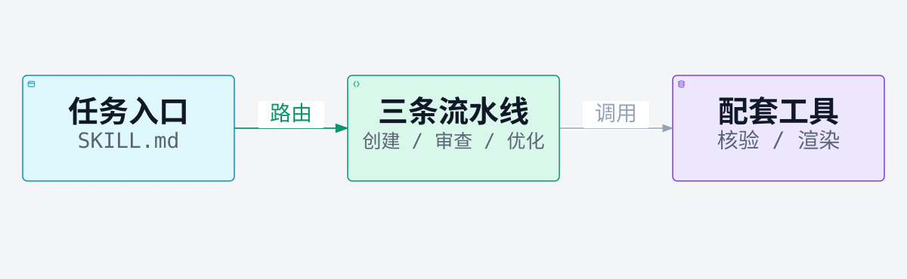

# readmex

用创建、审查、优化三条流水线，把 README 写成能对照仓库核对的正文。对话里的 AI 读取 `skills/readmex` 后写作；扫描、机械检查和渲染由仓库里的脚本完成。

<p align="center">
  
</p>

[静态头图](readme/assets/hero.svg) · [合成头图](readme/assets/hero.png)

三条流水线可以分开用。快速创建只起稿；审查对照仓库核对主张；优化把需要保留的图做成静态 SVG。生图和 GIF 都要明确同意后才会做。

## 先试一次

在还没有 `README.md` 的项目里发送：

```text
/readmex 快速写一份中文 README
```

正文写到该项目根目录的 `README.md`。文件已经存在时，快速创建改为审查，先给出记分卡。只有明确要求重写，或走完整流程，才会改已有正文。

| 你想做什么 | 可以这样说 |
| --- | --- |
| 快速起稿 | `/readmex 快速写一份中文 README` |
| 先看问题 | `/readmex 审查 README，先给记分卡` |
| 整页美化 | `/readmex 美化 README，整页优化` |
| 只做素材 | `/readmex 只制作架构图素材` |
| 完整改写 | `/readmex 完整重写 README，执行全流程` |

> [!NOTE]
> 只说「写个 README」时，技能会先问要快速简洁的，还是完整清晰并且有配图的。完整流程遇到已有 README 时从审查开始，然后继续优化。

## 安装

需要能加载 Agent Skills 的工具。技能目录是 `skills/readmex`，安装时整目录复制。Cursor 的用户技能目录是 `~/.cursor/skills`：

```bash
mkdir -p "$HOME/.cursor/skills"
cp -R skills/readmex "$HOME/.cursor/skills/readmex"
```

目录已存在时，用新的 `skills/readmex` 整目录替换。其他工具把同一目录放到自己的技能目录。下一轮对话用 `/readmex` 调用。

| 用途 | 要求 |
| --- | --- |
| 扫描、机械检查、GIF 脚本 | Python 3（标准库） |
| 架构图、流程图 | Node.js 18 或更新版本，无需 `npm install` |
| GIF（可选） | Pillow、ffmpeg，以及 `rsvg-convert` 或 macOS `sips` |

## 完整流程

<p align="center">
  
</p>

[静态流程图](readme/assets/workflow.svg)

从左到右是合并执行的顺序：创建把 `README.md` 写到目标仓库，审查核对主张，优化把图换成静态 SVG。已有 README 时跳过创建。单独审查要等你同意后才改正文；完整流程写完记分卡后继续。通过条件见 [记分卡](skills/readmex/references/review-scorecard.md)：五项阻断全部通过，八项至少 14/16。机械脚本只报告事实，不打分。

## 请求如何落到仓库

<p align="center">
  
</p>

作者在对话里提出请求，`SKILL.md` 选择一条流水线，正文写入目标仓库根目录的 `README.md`。图里的颜色只区分三个部分，正文是仓库里的文件。审查和优化需要时才调用扫描、机械检查和 `render-diagram.mjs`。

```text
<目标仓库>/
├── README.md          # 最终正文
├── readme/assets/     # 正文引用的图
└── .readmex/          # 扫描、记分卡、图的源文件和预览
```

技能会在目标仓库的 `.gitignore` 里加入 `.readmex/`（若还没有这一行）。源码引用按当前文件和行号核对，核对失败就不发布那张图。

```bash
python3 skills/readmex/scripts/scan.py <目标仓库> --output <目标仓库>/.readmex/scan.json
python3 skills/readmex/scripts/readme_factor_audit.py <目标仓库>
python3 skills/readmex/scripts/readme_view_audit.py <目标仓库>/README.md
node skills/readmex/bin/render-diagram.mjs <图.json> --repo-root <目标仓库>
```

`diagram_type` 只能是 `architecture` 或 `workflow`。`--layout-json` 只输出布局，不写图片。

进一步阅读：[技能入口](skills/readmex/SKILL.md) · [审查尺度](skills/readmex/references/review-scorecard.md) · [图表写作与渲染](skills/readmex/references/renderer-authoring.md)。

## 状态

本文对应 `skill` 分支。该分支把三条流水线收进现在的技能目录；最近一次整合提交是 2026-11-05 的 `9dfde21`。技能用自然语言选择流水线，没有单独的版本化命令行接口。

## 许可

[MIT 许可证](LICENSE.txt)。第三方材料见 [第三方许可通知](skills/readmex/THIRD_PARTY_NOTICES)：架构与流程渲染器改编自 [Archify](https://github.com/tt-a1i/archify)，快速创建说明改编自 [awesome-copilot](https://github.com/github/awesome-copilot)。
